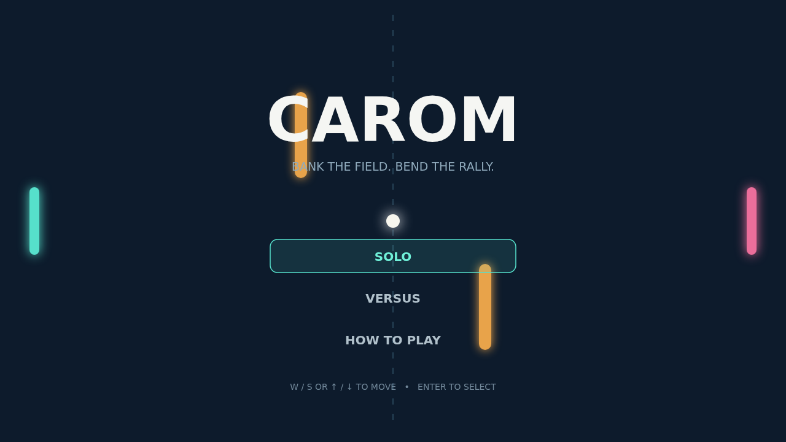

# Carom

A rally begins with a quiet second at center court. Then the serve cuts across the field and both paddles race to meet it. In solo play, face a quick AI; in versus, hand the keyboard to a friend.

A clean hit sends the ball back across the field. Catch it near the paddle's edge for a sharp angle, or move with the contact to add spin and make the flight curl. Every rally asks you to read where the ball will be, not just where it is.

Two rotating bars sway through the center lanes. Their tilted faces turn safe shots into bank shots, and a well-timed ricochet can slip past a waiting paddle. First to eleven with a two-point lead takes the match.

